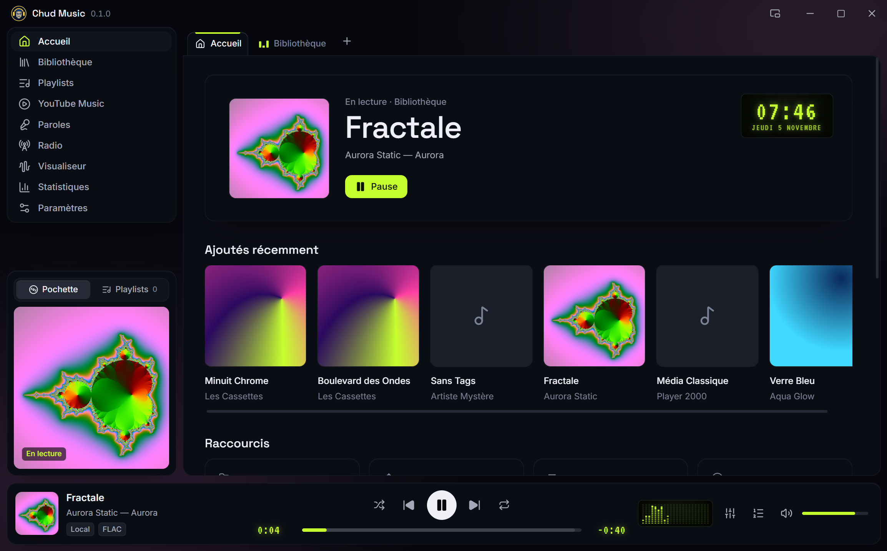

<div align="center">


# Chud Music

**Le lecteur musical de bureau, moderne et rétro.**
Vos fichiers, YouTube Music, la radio du monde entier et les paroles synchronisées, dans une seule application.

[](https://github.com/BigFatDeuce/Chud-Music/releases/latest)
[](https://github.com/BigFatDeuce/Chud-Music/releases)


[**Télécharger**](#télécharger) · [Fonctionnalités](#fonctionnalités) · [Skins](#cinq-skins) · [Installation](#installation) · [Vie privée](#vie-privée)



</div>

## Télécharger

| Système | Fichier | |
|---|---|---|
| **Windows** 10 et 11 (64 bits) | `Chud-Music-Setup-x.y.z.exe` | [Dernière version](https://github.com/BigFatDeuce/Chud-Music/releases/latest) |
| **Linux** x86_64 (AppImage) | `Chud-Music-x.y.z-x86_64.AppImage` | [Dernière version](https://github.com/BigFatDeuce/Chud-Music/releases/latest) |

Gratuit, sans compte, sans publicité. Chaque installation est indépendante : aucune clé, aucun identifiant ni réglage personnel n'est fourni avec l'application.

## Fonctionnalités

### Votre musique, tous les formats
- **Bibliothèque** : ajoutez vos dossiers (sous-dossiers compris), Chud Music lit les tags et les pochettes et suit les nouveaux fichiers. Vue par titres, albums ou artistes, recherche instantanée, même avec des milliers de morceaux.
- **Tous les formats courants** : MP3, FLAC, AAC/M4A, Ogg, Opus, WAV… et aussi ALAC, WMA, AIFF, WavPack, AC3 ou TTA, convertis à la volée par FFmpeg (fourni).
- **Double-clic dans l'Explorateur** : le fichier s'ouvre dans l'onglet *Fichiers ouverts* de la fenêtre déjà lancée, les suivants s'y ajoutent.
- **Onglets, playlists et file d'attente** : glisser-déposer partout, réorganisation à la souris, le même morceau peut figurer deux fois dans une playlist.
- **Vos fichiers ne sont jamais modifiés ni supprimés.** Retirer un morceau de la bibliothèque ne touche pas au disque.


### YouTube Music, sans compte
Recherchez des titres, albums et artistes, lancez un mix : la lecture passe par le **lecteur officiel de YouTube**, affiché dans l'application. Aucune connexion Google, aucun téléchargement, aucune extraction de flux. Un bloqueur de publicités (listes de filtres d'uBlock Origin, mises à jour automatiquement) peut être activé ou désactivé dans les paramètres.

### Radio du monde entier
Des dizaines de milliers de radios par pays, les plus écoutées d'abord, grâce à l'annuaire libre [Radio Browser](https://www.radio-browser.info). Recherche, favoris en tête de liste, titre en cours affiché quand la station le diffuse.


### Paroles synchronisées
Les paroles du morceau en cours, synchronisées ligne par ligne quand elles existent, grâce à [LRCLIB](https://lrclib.net). Sinon, l'application l'indique clairement et propose une recherche manuelle.

### Visualiseur MilkDrop
Des centaines de presets MilkDrop (butterchurn) qui réagissent à la musique, en plein écran si vous voulez, avec enchaînement automatique.


### Et aussi
- **Égaliseur 10 bandes** avec préampli, préréglages (Rock, Pop, Jazz, Voix…) et vos propres réglages.
- **Statistiques d'écoute** : temps d'écoute, séries, heures et jours préférés, tops titres, artistes et albums, sources.
- **Mini lecteur** toujours au premier plan, pochette et commandes seulement.
- **Touches multimédias** du clavier (lecture, suivant, précédent) et boutons dans la miniature de la barre des tâches Windows.
- **Choix de la sortie audio** (casque, enceintes, interface audio) dans les paramètres ou d'un clic droit sur le volume.
- **Taille de l'interface** réglable, mise en page qui s'adapte aux fenêtres étroites et aux écrans verticaux.
- **Mises à jour** : l'application signale les nouvelles versions publiées ici (vérification désactivable).

<p align="center">
  
  
</p>

## Cinq skins

*Chud Nocturne* (sombre, vert LCD, ci-dessus), *Cassette 98* (plastique biseauté, années 90), *Aqua Glow* (verre bleu nuit, années 2000), *Platine* (gris clair, le plus lisible) et *Signal* (graphite, glitchs de vieux moniteur, ASCII et tramage). Couleur d'accent au choix et trois niveaux d'effets : complets, réduits ou désactivés.

| Cassette 98 | Aqua Glow |
|---|---|
|  |  |
| **Platine** | **Signal** |
|  |  |

## Installation

### Windows
1. Téléchargez `Chud-Music-Setup-x.y.z.exe` depuis la [dernière version](https://github.com/BigFatDeuce/Chud-Music/releases/latest) et lancez-le.
2. L'installeur n'est pas signé numériquement : Windows SmartScreen peut afficher « Windows a protégé votre ordinateur ». Cliquez sur **Informations complémentaires**, puis **Exécuter quand même**.
3. Choisissez le dossier d'installation. Aucun droit administrateur n'est nécessaire par défaut.

Les mises à jour se font ensuite depuis l'application, en un clic. Vos données sont conservées.

### Linux (AppImage)
```bash
chmod +x Chud-Music-*-x86_64.AppImage
./Chud-Music-*-x86_64.AppImage
```
Testé sur Fedora 45. Les AppImage ont besoin de FUSE 2, déjà présent sur la plupart des distributions ; sur Ubuntu 24.04 : `sudo apt install libfuse2t64` (22.04 : `libfuse2`).

## Vie privée

- **Pas de compte, pas de télémétrie, pas de statistiques envoyées.** Votre bibliothèque, vos playlists, vos réglages et vos statistiques d'écoute restent sur votre ordinateur.
- Chud Music ne contacte Internet que pour ce que vous utilisez :
  YouTube (recherche et lecteur officiel, quand vous ouvrez YouTube Music),
  Radio Browser (liste des radios) et la station choisie,
  LRCLIB (paroles),
  les listes de filtres d'uBlock Origin (si le bloqueur est activé),
  GitHub (vérification des mises à jour, désactivable).
- Données de l'application : `%APPDATA%\Chud Music` sous Windows, `~/.config/Chud Music` sous Linux. Une sauvegarde de la base est faite avant chaque mise à jour de son format.

## Licences et crédits

Chud Music s'appuie sur des logiciels libres, livrés avec leurs licences (fichier `THIRD-PARTY-NOTICES.txt` dans le dossier de l'application) :

- [FFmpeg](https://ffmpeg.org) (LGPL 2.1 ou ultérieure), compilé sans bibliothèque externe, programme séparé et remplaçable. Ses sources exactes sont jointes à chaque version publiée.
- [Electron](https://www.electronjs.org) et Chromium, [React](https://react.dev), [Motion](https://motion.dev), [Lucide](https://lucide.dev), [three.js](https://threejs.org).
- [butterchurn](https://github.com/jberg/butterchurn) et ses presets MilkDrop, [music-metadata](https://github.com/Borewit/music-metadata), [YouTube.js](https://github.com/LuanRT/YouTube.js), [Ghostery adblocker](https://github.com/ghostery/adblocker) (MPL 2.0) avec les listes de [uBlock Origin](https://github.com/uBlockOrigin/uAssets) (GPL v3, téléchargées par l'application).
- Effets de [Canvas UI](https://canvasui.com) (MIT + Commons Clause).
- Polices Inter, Space Grotesk et VT323 (SIL Open Font License).
- Données : [Radio Browser](https://www.radio-browser.info), [LRCLIB](https://lrclib.net).

Chud Music n'est ni affilié à YouTube ou Google, ni approuvé par eux. YouTube est une marque de Google LLC.
