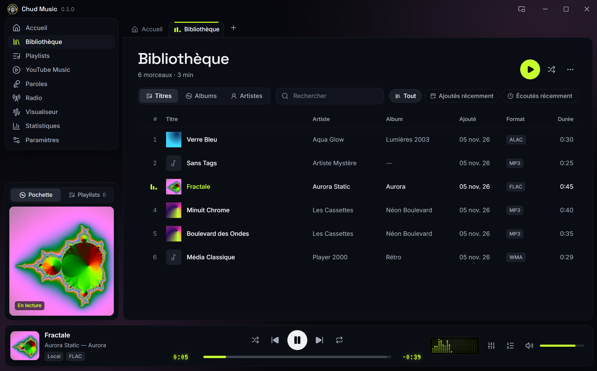
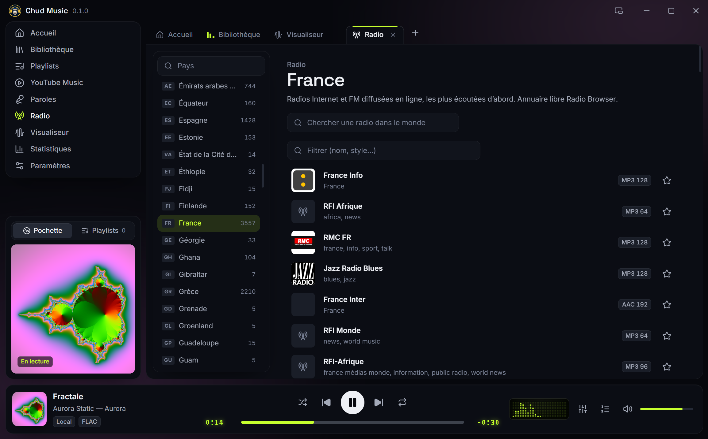
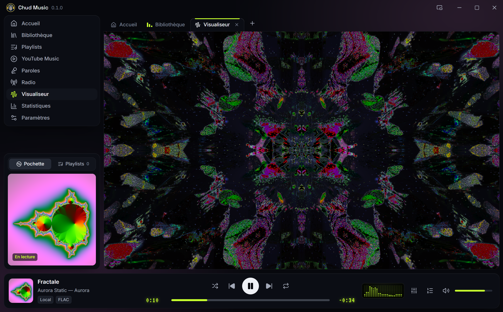
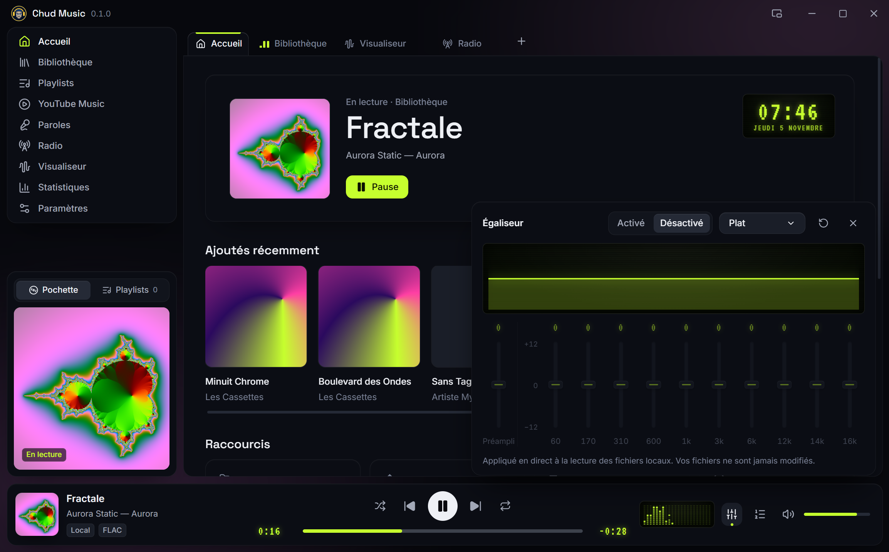
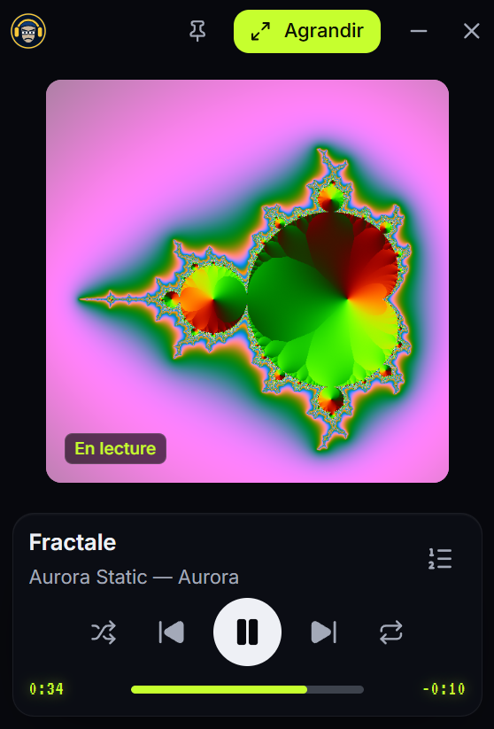
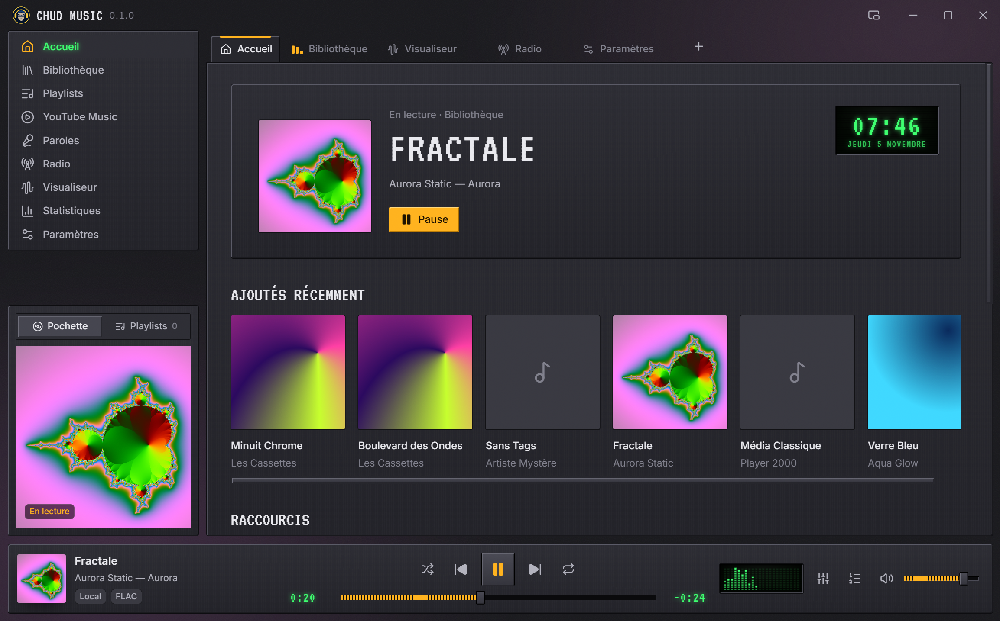
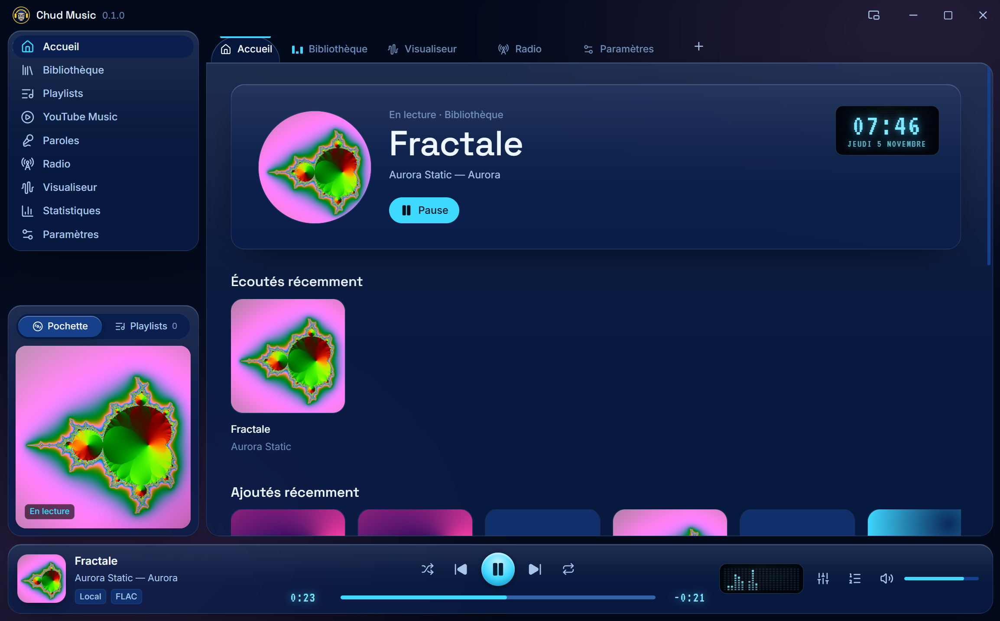
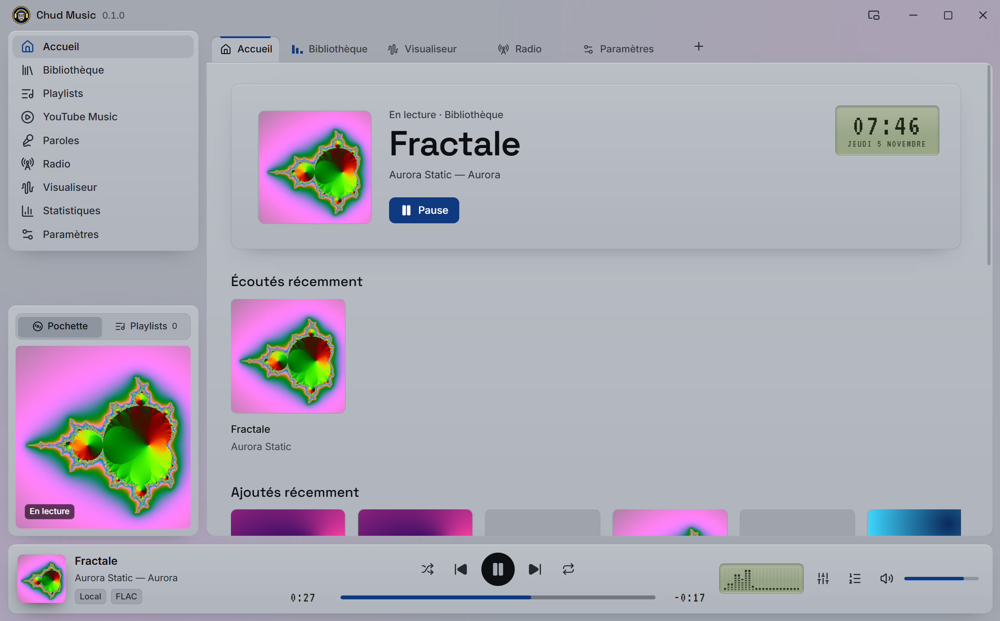
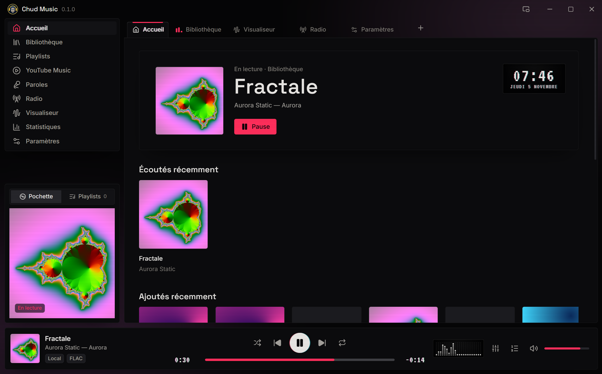

<div align="center">


# Chud Music

**The desktop music player, modern and retro.**
Your files, YouTube Music, radio from all over the world and synced lyrics, in one app.

[](https://github.com/BigFatDeuce/Chud-Music/releases/latest)
[](https://github.com/BigFatDeuce/Chud-Music/releases)


[**Download**](#download) · [Features](#features) · [Skins](#five-skins) · [Installation](#installation) · [Privacy](#privacy)


</div>

> **Languages:** English, French, Spanish, German, Italian, Portuguese (Brazil), Russian, Japanese, Simplified Chinese and Korean. Chud Music follows your system language by default; you can change it in Settings › Language.

## Download

| System | File | |
|---|---|---|
| **Windows** 10 and 11 (64-bit) | `Chud-Music-Setup-x.y.z.exe` | [Latest release](https://github.com/BigFatDeuce/Chud-Music/releases/latest) |
| **Linux** x86_64 (AppImage) | `Chud-Music-x.y.z-x86_64.AppImage` | [Latest release](https://github.com/BigFatDeuce/Chud-Music/releases/latest) |

Free, no account, no ads. Every installation is independent: no key, no credential and no personal setting ships with the app.

## Features

### Your music, every format
- **Library**: add your folders (subfolders included). Chud Music reads tags and covers and picks up new files. Browse by tracks, albums or artists, with instant search, even across thousands of tracks.
- **All common formats**: MP3, FLAC, AAC/M4A, Ogg, Opus, WAV… plus ALAC, WMA, AIFF, WavPack, AC3 or TTA, converted on the fly by FFmpeg (included).
- **Double-click in your file manager**: the file opens in the *Opened files* tab of the running window, and the next ones join it.
- **Tabs, playlists and queue**: drag and drop everywhere, reorder tracks and tabs with the mouse, the same track can appear twice in a playlist.
- **Your files are never modified or deleted.** Removing a track from the library does not touch the disk.



### YouTube Music, no account
Search tracks, albums and artists, start a mix: playback goes through **YouTube's official player**, shown inside the app. No Google sign-in, no download, no stream extraction. An ad blocker (uBlock Origin filter lists, updated automatically) can be turned on or off in the settings.

**Paste a YouTube or Spotify link** (track, album or playlist) into the search box: Chud Music finds the same music on YouTube Music, ready to play or to save as a playlist. Artist and album names of YouTube Music tracks open their pages in the app, and a right-click on one of your own files finds its artist on YouTube Music.

When the window is narrow, the YouTube player moves into the player bar: the controls stay exactly where they are, and above them you get the **synced lyrics** or, when there are none, the **track card** (artist, album, your listening history, and links to learn more about the artist on YouTube Music, Wikipedia, Grokipedia, Last.fm and Discogs).

### Radio from all over the world
Tens of thousands of stations by country, most listened first, thanks to the open directory [Radio Browser](https://www.radio-browser.info). Search, favorites on top, and the title on air when the station broadcasts it.



### Synced lyrics
The lyrics of the track playing, synced line by line when available, thanks to [LRCLIB](https://lrclib.net). Otherwise the app says so and lets you search by hand. When one of your files has lyrics, a **Synced Lyrics** or **Lyrics** button appears in the player bar.

### Video clip tab
Right-click a track › *Open the video clip*: the music plays big in its own tab, with its lyrics on the right, or below in *Large* mode, and a full-screen button. YouTube Music songs play as their official music video when one exists. Your own files show their cover, the artist's picture from YouTube Music, or a looping VHS tape. The next tracks stay in the same layout.

### MilkDrop visualizer
Hundreds of MilkDrop presets (butterchurn) reacting to the music, full screen if you like, with automatic cycling.



### And also
- **10-band equalizer** with preamp, presets (Rock, Pop, Jazz, Vocals…) and your own settings.
- **Listening statistics**: listening time, streaks, favorite hours and days, top tracks, artists and albums, sources.
- **Mini player**, always on top, cover and controls only.
- **Random shelf on Home**: tracks from your library, drawn at each launch.
- **Media keys** (play, next, previous) and buttons in the Windows taskbar thumbnail.
- **Audio output choice** (headphones, speakers, audio interface) in the settings or with a right-click on the volume.
- **10 interface languages**, the system's by default.
- **Adjustable interface size**, and a layout that adapts to narrow windows and portrait screens.
- **Updates**: the app tells you when a new version is published here (the check can be turned off).

<p align="center">
  
  
</p>

## Five skins

*Chud Nocturne* (dark, LCD green, above), *Cassette 98* (bevelled plastic, the '90s), *Aqua Glow* (midnight-blue glass, the 2000s), *Platine* (light grey, the most readable) and *Signal* (graphite, old-monitor glitches, ASCII, dithering, a glitchy timecode clock and glitchy player buttons). Accent color of your choice, and three effect levels: full, reduced or off.

| Cassette 98 | Aqua Glow |
|---|---|
|  |  |
| **Platine** | **Signal** |
|  |  |

## Installation

### Windows
1. Download `Chud-Music-Setup-x.y.z.exe` from the [latest release](https://github.com/BigFatDeuce/Chud-Music/releases/latest) and run it.
2. The installer is not code-signed: Windows SmartScreen may show "Windows protected your PC". Click **More info**, then **Run anyway**.
3. Choose the installation folder. No administrator rights are needed by default.

Updates then happen from inside the app, in one click. Your data is kept.

### Linux (AppImage)
```bash
chmod +x Chud-Music-*-x86_64.AppImage
./Chud-Music-*-x86_64.AppImage
```
Tested on Fedora 45. AppImages need FUSE 2, already present on most distributions; on Ubuntu 24.04: `sudo apt install libfuse2t64` (22.04: `libfuse2`).

## Privacy

- **No account, no telemetry, no statistics sent anywhere.** Your library, playlists, settings and listening statistics stay on your computer.
- Chud Music only goes online for what you use:
  YouTube (search and official player, when you open YouTube Music),
  Spotify's public embed page (only when you paste a Spotify link, to read the track names),
  Radio Browser (station list) and the station you pick,
  LRCLIB (lyrics),
  uBlock Origin filter lists (if the ad blocker is on),
  GitHub (update check, can be turned off).
- To animate its little spectrum while YouTube plays, the app measures the sound levels of the official player; playback is not changed and nothing is recorded.
- App data: `%APPDATA%\Chud Music` on Windows, `~/.config/Chud Music` on Linux. The database is backed up before every change of its format.

## Licenses and credits

Chud Music is built on open-source software, shipped with their licenses (`THIRD-PARTY-NOTICES.txt` in the app folder):

- [FFmpeg](https://ffmpeg.org) (LGPL 2.1 or later), built without any external library, as a separate, replaceable program. Its exact source code is attached to every release.
- [Electron](https://www.electronjs.org) and Chromium, [React](https://react.dev), [Motion](https://motion.dev), [Lucide](https://lucide.dev), [three.js](https://threejs.org).
- [butterchurn](https://github.com/jberg/butterchurn) and its MilkDrop presets, [music-metadata](https://github.com/Borewit/music-metadata), [YouTube.js](https://github.com/LuanRT/YouTube.js), [Ghostery adblocker](https://github.com/ghostery/adblocker) (MPL 2.0) with the [uBlock Origin](https://github.com/uBlockOrigin/uAssets) lists (GPL v3, downloaded by the app).
- Effects from [Canvas UI](https://canvasui.dev) (MIT + Commons Clause).
- Inter, Space Grotesk and VT323 fonts (SIL Open Font License).
- Data: [Radio Browser](https://www.radio-browser.info), [LRCLIB](https://lrclib.net).

Chud Music is not affiliated with or endorsed by YouTube, Google or Spotify. YouTube is a trademark of Google LLC; Spotify is a trademark of Spotify AB.
